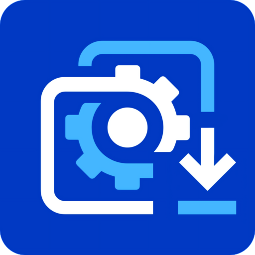

<div align="center">
  
  <h1>WallHub for Android</h1>
  <p><strong>在 Android 手机上探索、播放、下载和导入 Wallpaper Engine 创意工坊内容。</strong></p>
  <p>
    <a href="README_EN.md">English</a> ·
    <a href="https://github.com/ChEnLeo-7/WallHub2.0-For-Android/releases/latest">下载最新版</a> ·
    <a href="https://github.com/ChEnLeo-7/WallHub2.0-For-Android/issues">反馈问题</a>
  </p>
</div>

[](https://github.com/ChEnLeo-7/WallHub2.0-For-Android/actions/workflows/verify.yml) [](https://github.com/ChEnLeo-7/WallHub2.0-For-Android/releases/latest) [](LICENSE)

WallHub for Android 是一款独立的原生 Android 客户端，帮助你直接在手机上浏览和管理 Wallpaper Engine 创意工坊内容。无需电脑或额外服务，即可在线播放视频壁纸、转换并导入兼容作品，并在国内直连网络环境下访问 Steam。

**📱 原生 Android 应用** · **▶️ 视频免下载在线播放** · **📦 PKG 转 MPKG 导入** · **🌐 Steam 国内直连支持**

> [!NOTE]
> WallHub 是非官方客户端，与 Valve、Steam、Wallpaper Engine 团队及创意工坊作者没有官方隶属、授权或背书关系。

## ✨ 核心功能

| 能力 | 说明 |
| :--- | :--- |
| **▶️ 视频在线播放** | 无需先下载，即可在线播放支持的视频类壁纸。 |
| **📦 转换并导入** | 将场景类或视频类作品从 PKG 转换为 MPKG，再导入官方 Wallpaper Engine Android 客户端。 |
| **🌐 Steam 国内直连** | 针对中国大陆直连网络环境提供 Steam 访问支持，无需配置代理；实际可用性取决于当地网络状况。 |
| **🔎 创意工坊浏览** | 搜索、筛选和查看作品详情、预览与评论。 |
| **⭐ Steam 资料库** | 登录后查看和管理个人订阅与收藏。 |
| **📂 本地管理** | 整理已下载壁纸，支持收藏、分享和删除。 |

## 🚀 快速开始

### 📲 安装应用

1. 前往 [GitHub Releases](https://github.com/ChEnLeo-7/WallHub2.0-For-Android/releases/latest) 下载最新的 `arm64-v8a` APK。
2. 在 Android 设备上安装 APK。若系统提示，允许本次安装来源安装应用。
3. 打开 WallHub，开始浏览创意工坊。登录 Steam 后可使用个人订阅与收藏功能。

最低要求：Android 8.0 或更高版本。浏览创意工坊和使用 Steam 账户功能需要设备能够连接 Steam 服务。

> [!TIP]
> Release 页面提供 APK 的 SHA-256 校验值。下载后可按页面说明核对文件；只安装你信任来源的 APK。若更新时提示签名不匹配，请勿直接覆盖安装。卸载旧版本可能会删除应用数据。

### 📦 导入到 Wallpaper Engine

在 WallHub 中下载并转换兼容的场景或视频作品，生成 MPKG 文件后选择导入。设备需要预先安装官方 Wallpaper Engine Android 客户端。是否能正常导入和播放取决于作品内容及其兼容性。

## 🧭 基本使用

1. 在首页搜索或筛选创意工坊作品，打开作品详情查看预览和说明。
2. 视频类作品可尝试在线播放；也可以下载到本地。
3. 需要在官方客户端中使用的场景或视频作品，下载后转换为 MPKG 并导入。
4. 登录 Steam 后，可在应用中查看订阅与收藏并管理作品。

> [!IMPORTANT]
> Steam 连接能力受网络环境影响。国内直连支持不代表所有网络、账户或创意工坊作品均保证可用。请遵守 Steam、Wallpaper Engine 和作品作者的使用条款。

## 🛠️ 从源码构建

需要 Android Studio、JDK 17 或更高版本，以及 Android SDK Platform 36 和 Build Tools 35.0.0。

```bash
./gradlew :app:assembleDebug
```

Windows 使用：

```powershell
./gradlew.bat :app:assembleDebug
```

Debug APK 输出到 `app/build/outputs/apk/debug/app-debug.apk`。项目使用 Kotlin 和 Jetpack Compose；主要应用代码位于 `app/src/main/kotlin`。

## ❓ 常见问题

<details>
<summary>为什么安装时提示应用不兼容？</summary>

GitHub Release 提供 `arm64-v8a` APK，适用于大多数现代 Android 手机和平板。Android 版本需为 8.0 或更高。

</details>

<details>
<summary>为什么无法覆盖安装？</summary>

Android 只允许使用相同签名证书的 APK 覆盖安装。若签名不一致，需要确认 APK 来源；卸载旧版本后再安装会删除应用数据。

</details>

<details>
<summary>为什么作品无法播放或导入？</summary>

不同创意工坊作品的格式和资源各异。请确认网络连接正常；导入 MPKG 还需要官方 Wallpaper Engine Android 客户端。部分作品可能不兼容手机端。

</details>

<details>
<summary>在哪里报告问题？</summary>

请先查看现有的 [GitHub Issues](https://github.com/ChEnLeo-7/WallHub2.0-For-Android/issues)。提交问题时请提供 Android 版本、WallHub 版本和复现步骤；不要附上密码、Cookie、令牌或其他账户凭据。

</details>

## 🙏 致谢

WallHub 使用 [Jetpack Compose](https://developer.android.com/compose)、[Material 3](https://m3.material.io/)、[AndroidX Media3](https://developer.android.com/media/media3)、[Room](https://developer.android.com/training/data-storage/room) 和 [WorkManager](https://developer.android.com/topic/libraries/architecture/workmanager) 等开源项目。感谢相关项目的维护者与贡献者。

## ⚖️ 免责声明

WallHub 不提供或托管创意工坊内容。作品版权、授权和使用限制归作者或其他权利人所有。请遵守平台规则和所在地法律，勿未经授权分发作品。软件按 [MIT License](LICENSE)“现状”提供，使用者应自行承担使用风险。

---

**WallHub 对你有帮助？欢迎留下 Star 或反馈问题。**

[Star 项目](https://github.com/ChEnLeo-7/WallHub2.0-For-Android/stargazers) · [反馈问题](https://github.com/ChEnLeo-7/WallHub2.0-For-Android/issues) · [下载最新版](https://github.com/ChEnLeo-7/WallHub2.0-For-Android/releases/latest)
