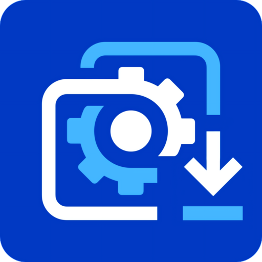

<div align="center">
  
  <h1>WallHub for Android</h1>
  <p><strong>Explore, play, download, and import Wallpaper Engine Workshop content on Android.</strong></p>
  <p>
    <a href="README.md">简体中文</a> ·
    <a href="https://github.com/ChEnLeo-7/WallHub2.0-For-Android/releases/latest">Latest release</a> ·
    <a href="https://github.com/ChEnLeo-7/WallHub2.0-For-Android/issues">Report an issue</a>
  </p>
</div>

[](https://github.com/ChEnLeo-7/WallHub2.0-For-Android/actions/workflows/verify.yml) [](https://github.com/ChEnLeo-7/WallHub2.0-For-Android/releases/latest) [](LICENSE)

WallHub for Android is an independent native Android client for browsing and managing Wallpaper Engine Workshop content on your phone. No PC or extra service is needed to stream video wallpapers, convert and import compatible items, or access Steam directly on supported mainland China networks.

**📱 Native Android app** · **▶️ Stream video without downloading** · **📦 Convert PKG to MPKG** · **🌐 Direct Steam access in China**

> [!NOTE]
> WallHub is unofficial and is not affiliated with, authorized by, or endorsed by Valve, Steam, the Wallpaper Engine team, or Workshop creators.

## ✨ Highlights

| Capability | What it does |
| :--- | :--- |
| **▶️ Video streaming** | Play supported video wallpapers online without downloading them first. |
| **📦 Convert and import** | Convert scene or video items from PKG to MPKG, then import them into the official Wallpaper Engine Android client. |
| **🌐 Direct Steam access in China** | Supports direct Steam access on mainland China networks without proxy configuration; availability depends on local network conditions. |
| **🔎 Workshop browsing** | Search, filter, and view item details, previews, and comments. |
| **⭐ Steam library** | Sign in to view and manage your subscriptions and favorites. |
| **📂 Local management** | Organize downloaded wallpapers, with options to favorite, share, and delete them. |

## 🚀 Quick Start

### 📲 Install the app

1. Open [GitHub Releases](https://github.com/ChEnLeo-7/WallHub2.0-For-Android/releases/latest) and download the latest `arm64-v8a` APK.
2. Install the APK on your Android device. If prompted, allow this source to install apps for this installation.
3. Open WallHub and browse the Workshop. Sign in to Steam to access your personal subscriptions and favorites.

Requires Android 8.0 or newer. Workshop browsing and Steam account features require a network connection to Steam services.

> [!TIP]
> Releases include the APK's SHA-256 checksum. Verify the downloaded file against the value on the release page, and install APKs only from sources you trust. If an update reports a signature mismatch, do not install over the existing app. Uninstalling the old version may delete its data.

### 📦 Import into Wallpaper Engine

Download and convert a compatible scene or video item in WallHub to create an MPKG file, then choose Import. The official Wallpaper Engine Android client must already be installed. Import and playback compatibility depends on each item's content.

## 🧭 Basic Usage

1. Search or filter Workshop items from the home screen, then open an item to view its preview and details.
2. Try online playback for video items, or download them for local use.
3. To use a scene or video item in the official client, download it, convert it to MPKG, and import it.
4. Sign in to Steam to view subscriptions and favorites and manage items.

> [!IMPORTANT]
> Steam connectivity depends on the network environment. Direct-access support in China does not guarantee availability on every network, account, or Workshop item. Follow Steam, Wallpaper Engine, and creator terms.

## 🛠️ Build from Source

Install Android Studio, JDK 17 or newer, Android SDK Platform 36, and Build Tools 35.0.0.

```bash
./gradlew :app:assembleDebug
```

On Windows:

```powershell
./gradlew.bat :app:assembleDebug
```

The Debug APK is generated at `app/build/outputs/apk/debug/app-debug.apk`. The app is built with Kotlin and Jetpack Compose; primary application code is under `app/src/main/kotlin`.

## ❓ FAQ

<details>
<summary>Why does Android say the app is incompatible?</summary>

GitHub Releases provide an `arm64-v8a` APK for most modern Android phones and tablets. Android 8.0 or newer is required.

</details>

<details>
<summary>Why can't I install over the existing app?</summary>

Android only allows an APK to update an existing app when both use the same signing certificate. Verify the APK source if the signatures differ. Uninstalling the old version before installing the new one will delete its app data.

</details>

<details>
<summary>Why won't an item play or import?</summary>

Workshop items use different formats and assets. Check your network connection. MPKG import also requires the official Wallpaper Engine Android client, and some items may not be compatible with mobile devices.

</details>

<details>
<summary>Where can I report a problem?</summary>

Check existing [GitHub Issues](https://github.com/ChEnLeo-7/WallHub2.0-For-Android/issues) first. Include your Android version, WallHub version, and reproduction steps. Do not include passwords, cookies, tokens, or other account credentials.

</details>

## 🙏 Acknowledgements

WallHub uses open-source projects including [Jetpack Compose](https://developer.android.com/compose), [Material 3](https://m3.material.io/), [AndroidX Media3](https://developer.android.com/media/media3), [Room](https://developer.android.com/training/data-storage/room), and [WorkManager](https://developer.android.com/topic/libraries/architecture/workmanager). Thanks to their maintainers and contributors.

## ⚖️ Disclaimer

WallHub does not provide or host Workshop content. Copyright, permissions, and restrictions for each item belong to its creator or other rights holders. Follow platform rules and local laws; do not distribute content without authorization. The software is provided “as is” under the [MIT License](LICENSE), and users assume the risks of its use.

---

**Finding WallHub useful? Leave a Star or report an issue.**

[Star the project](https://github.com/ChEnLeo-7/WallHub2.0-For-Android/stargazers) · [Report an issue](https://github.com/ChEnLeo-7/WallHub2.0-For-Android/issues) · [Get the latest release](https://github.com/ChEnLeo-7/WallHub2.0-For-Android/releases/latest)
